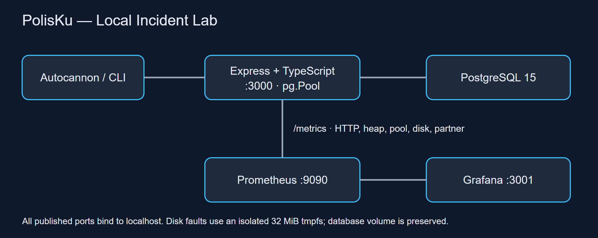

# PolisKu Incident Lab

A local incident-response portfolio for a : monitor a policy/claims API, investigate failures with SQL and runtime metrics, restore service, and communicate evidence-based findings.

The application is deliberately small. The deliverable is a reproducible investigation with honest impact statements and verifiable recovery.



## Run locally

Prerequisites: Docker Desktop with Linux containers. Node.js 20 and global autocannon are required for tests/injection (`npm install -g autocannon`).

```sh
docker compose up -d --build
node scripts/reset.js
node loadtest/autocannon-traffic.js --level light
```

First startup seeds 100k customers, 200k policies, 400k claims and 1M premium payments **only when the PostgreSQL volume is empty**. Wait for application health; on an existing lab the database volume is reused. Reset preserves existing data, clears simulated faults, and restores the intentionally unindexed claims baseline. Do not remove volumes to repeat an incident.

- API: [health](http://localhost:3000/health), [sample policy](http://localhost:3000/policies/1)
- [Grafana](http://localhost:3001): admin/admin for this localhost-only lab; anonymous access is disabled.
- [Prometheus](http://localhost:9090): 5-second scrape/evaluation interval.
- Published ports bind to localhost. Injection routes require explicit LAB_MODE=true, set only in the local Compose configuration.

## Investigations

| Incident | What is demonstrated | Report |
|---|---|---|
| Connection pool exhaustion | Leaked checkout, queued acquisition, 503, live error alert, recovery | [INC-001](docs/incidents/INC-001-connection-pool.md) |
| Memory retention | Retained objects, runtime memory and reference cleanup | [INC-002](docs/incidents/INC-002-memory-leak.md) |
| Missing index | Matching EXPLAIN/BUFFERS and HTTP load before/after composite index | [INC-003](docs/incidents/INC-003-slow-query.md) |
| Disk full | Live disk alert, real ENOSPC/507 in bounded 32 MiB tmpfs, truncate recovery | [INC-004](docs/incidents/INC-004-disk-full.md) |
| Partner deadline | 12s mock versus 2s timeout; honest 504, no false queue acknowledgement | [INC-005](docs/incidents/INC-005-downstream-timeout.md) |

[Latest verification evidence](docs/evidence/revalidation/) records timestamps, raw output and assertions. [Baseline](docs/baseline.md) reports three load profiles; [runbook](docs/runbook.md) explains diagnosis, reset and a 3–5 minute interview demo. [Communication drafts](docs/comms-templates.md) are simulations, not sent messages.


## Verification

```sh
npm --prefix app ci
npm --prefix app test
node scripts/verify-lab.js
```

The incident verification takes several minutes because it waits for live alert durations. Run one injection/load session at a time. PostgreSQL must be seeded for integration tests. Test-created claims are cleaned by ID. Scripts never drop volumes; load-test claims remain. `node scripts/reset.js --indexed` selects the optimized query state; the default returns to the deliberately missing-index state.

Prometheus rules have normal/abnormal tests in `infra/prometheus/alert.tests.yml`; copy that file into the Prometheus container and run `promtool test rules` as described in the runbook. Application tests cover reads, claim persistence, validation, request correlation and disabled-by-default simulation routes.

## What this portfolio proves

The most useful finding was that **a plausible RCA can still be wrong**: Docker stdout rotation does not rotate a separate application file, and an empty `local` driver config does not mean unlimited logs. The revised disk experiment isolates the actual failure and proves recovery without claiming a database outage.

Likewise, HTTP 202 cannot honestly mean work was queued when nothing was stored. The timeout experiment now reports failure explicitly and measures it.

## Current limits and next milestone

Validated locally on Docker Desktop. Incident-disk metrics describe tmpfs, and CPU/RSS metrics describe the Node process; neither is Windows host monitoring. The partner mock shares the application process. Heap alert behavior is tested synthetically; a new live heap-pressure firing is not claimed. Historical screenshots and artifacts are retained with corrections in the reports.

GitHub publication, GCP deployment, external notifications, Jira/Confluence links, a recorded demo and an independent fresh-clone walkthrough are pending. Once local validation is accepted, deploy the same tested revision to GCP and reproduce one or two incidents via restricted access. No cloud deployment evidence is claimed by this repository yet.
