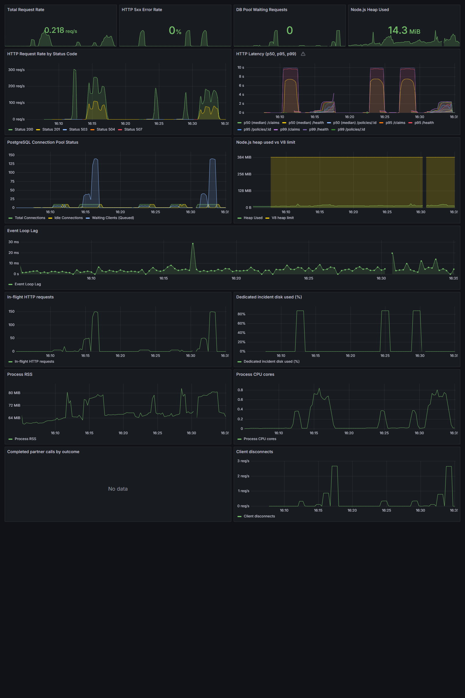

# Baseline lokal — 28 Oktober 2026

Sumber angka: [JSON asli](../loadtest/baseline-results.json). Hasil ini menggantikan tabel 26 Oktober yang memiliki angka berbeda dari artefaknya. Baseline-light.json adalah salinan profil ringan dari run yang sama.

| Profil | Koneksi / durasi | Respons | RPS rata-rata | p50 ms | p97.5 ms | p99 ms | Error / timeout / non-2xx |
|---|---|---|---|---|---|---|---|---|
| light | 10 / 30s | 6309 | 210.3 | 21 | 167 | 192 | 0 / 0 / 0 |
| medium | 50 / 60s | 15211 | 253.52 | 141 | 509 | 565 | 0 / 0 / 0 |
| heavy | 150 / 60s | 14672 | 244.54 | 506 | 1417 | 1619 | 0 / 0 / 0 |

## Metode dan batas kesimpulan

Komposisi per siklus: 10% health, 30% baca polis ID acak 1–200000, 30% daftar claims PENDING, 30% POST claims ID polis acak. Callback pengacakan dipasang di setiap request autocannon. Profil dijalankan berurutan dengan cooldown 10 detik, pada baseline tanpa index status. Tidak ada p95 tepat pada JSON autocannon; gunakan p97.5 yang tersedia atau estimasi histogram Grafana yang diberi label jelas.

JSON menyimpan timestamp/runId, HEAD, dirty state, OS, CPU, RAM host, versi Node, konfigurasi profil, metrik awal, sampling per detik selama beban, dan snapshot akhir. RAM host bukan limit Docker VM; Compose menetapkan limit app 512 MiB dan heap 384 MiB. Ini satu seri run pada mesin lokal yang juga menjalankan load generator, bukan janji kapasitas produksi atau batas maksimum universal.

Counter error autocannon sudah termasuk timeout; jangan menjumlahkannya lagi. Snapshot pool/heap setelah load bukan puncak. Sampel per detik dapat melewatkan spike singkat. Jumlah data bertambah karena POST claims; reset tidak menghapusnya. Nilai p95/p99 adalah distribusi request yang selesai, bukan representasi lengkap request yang dibatalkan klien.

## Interpretasi

Bandingkan profil dengan konkurensi yang sama. Antrean pada beban berat menunjukkan saturasi; bukan otomatis bukti connection leak. Query tanpa index adalah kondisi baseline yang sengaja disediakan untuk INC-003. Sesudah perbaikan index, gunakan benchmark insiden dengan query dan konfigurasi yang cocok.

[Skrip recovery dan kontrak reset](runbook.md) memeriksa baca dan persistensi klaim, kondisi fault, dan target aplikasi Prometheus. Screenshot baseline lama dipertahankan sebagai sejarah dan tidak menjadi acuan angka terbaru.
